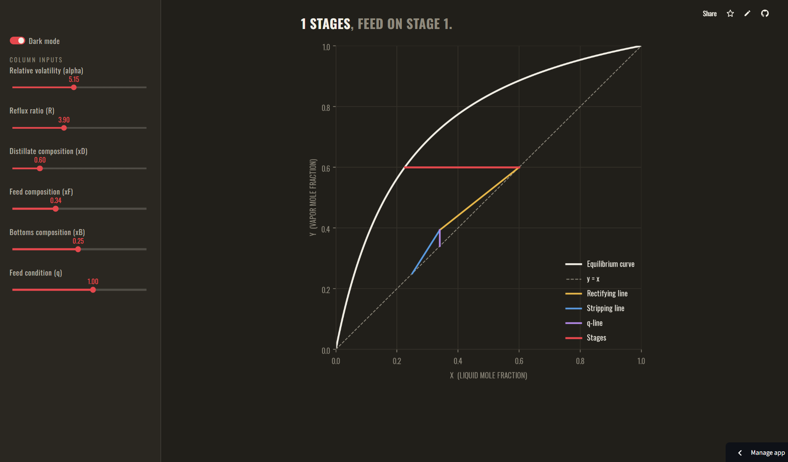

# McCabe-Thiele Distillation Calculator

An interactive web app that solves binary distillation problems with the McCabe-Thiele graphical method. Set the column conditions with the sliders and the app redraws the diagram, steps off the theoretical stages, and reports the stage count and feed stage.

**Live app:** [https://mccabe-thiele-4qiezsj9ajrupbsj547wxt.streamlit.app/](https://mccabe-thiele-4qiezsj9ajrupbsj547wxt.streamlit.app/)



## What it does

Given a binary mixture with constant relative volatility, the app:

- plots the equilibrium curve and the y = x diagonal
- draws the rectifying line, the stripping line, and the q-line
- steps off theoretical stages from the distillate down to the bottoms
- reports the number of theoretical stages, the feed stage, and the intersection of the operating lines
- handles any feed condition q, including subcooled liquid, saturated liquid, two-phase, saturated vapor, and superheated vapor
- rejects impossible inputs with a clear error message instead of crashing
- has a light and a dark theme

### Inputs

| Input | Symbol | Meaning |
| --- | --- | --- |
| Relative volatility | alpha | Ease of separation, must be greater than 1 |
| Reflux ratio | R | L/D at the top of the column, must be greater than 0 |
| Distillate composition | xD | Mole fraction of the light component in the distillate |
| Feed composition | xF | Mole fraction of the light component in the feed |
| Bottoms composition | xB | Mole fraction of the light component in the bottoms |
| Feed condition | q | Thermal condition of the feed |

The compositions must satisfy xB < xF < xD.

## The equations

**Equilibrium curve** (constant relative volatility):

```
y = alpha * x / (1 + (alpha - 1) * x)
x = y / (alpha - (alpha - 1) * y)        (inverse, used for stepping)
```

**Rectifying line:**

```
y = (R / (R + 1)) * x + xD / (R + 1)
```

**q-line:**

```
y = (q / (q - 1)) * x - xF / (q - 1)
```

When q = 1 the q-line is vertical at x = xF, so the intersection is handled as a special case.

**Intersection of the rectifying line and the q-line:**

```
x_i = (b_q - b_r) / (m_r - m_q)
```

where m and b are the slope and intercept of each line.

**Stripping line:** the straight line through (xB, xB) and the intersection point (x_i, y_i):

```
slope = (y_i - xB) / (x_i - xB)
y = xB + slope * (x - xB)
```

**Stage stepping:** start at (xD, xD). Move horizontally to the equilibrium curve (using the inverse equilibrium equation), count a stage, then move vertically to the operating line. Use the rectifying line while x is above x_i and the stripping line once x drops below it. The first stage that crosses x_i is the feed stage. Stop when x is at or below xB.

## Assumptions and limitations

- Binary mixture with constant relative volatility
- Constant molar overflow (straight operating lines)
- Equilibrium stages, 100 percent stage efficiency
- Total condenser, single feed
- The last stage is counted as a whole stage, so the result is not fractional
- If R is at or below the minimum reflux ratio, the steps pinch against the equilibrium curve and the app reports an error after 500 stages

## Worked example

Inputs: alpha = 2.5, R = 2, xD = 0.9, q = 1, xF = 0.6, xB = 0.1

| Stage | x | y after vertical move |
| --- | --- | --- |
| 1 | 0.7826 | 0.8217 |
| 2 | 0.6484 | 0.7322 |
| 3 (feed) | 0.5224 | 0.6069 |

The calculation finishes at **7 theoretical stages with the feed on stage 3**, which is also the case the test suite checks.

## Run it locally

Requires Python 3.10 or newer.

```bash
git clone https://github.com/kellbill/mccabe-thiele.git
cd mccabe-thiele
python -m venv .venv

# Windows
.venv\Scripts\activate
# macOS / Linux
source .venv/bin/activate

pip install -r requirements.txt
streamlit run app.py
```

The app opens at `http://localhost:8501`.

## Run the tests

```bash
pip install pytest
pytest -v
```

The tests check properties that must hold for any input, not just copied formulas. For example, the rectifying line passes through (xD, xD), the q-line passes through (xF, xF), the stripping line passes through (xB, xB) and through the operating line intersection, and increasing the reflux ratio never increases the stage count. They also cover invalid inputs and the plot output.

## Project structure

```
mccabe-thiele/
  app.py                  Streamlit interface only
  requirements.txt
  .streamlit/config.toml  Theme settings
  fonts/                  Oswald font for the chart (OFL licensed)
  src/
    equilibrium.py        Equilibrium curve and its inverse
    operating_lines.py    Rectifying, q-line, intersection, stripping
    stages.py             Stage stepping
    plotting.py           Matplotlib diagram
  tests/
    test_equilibrium.py
    test_operating_lines.py
    test_stages.py
    test_plotting.py
```

The calculation code in `src/` has no UI code in it, so it can be reused or tested without Streamlit.

## Built with

Python, NumPy, Matplotlib, Streamlit, pytest

## Roadmap

- Minimum reflux ratio and minimum stages (Fenske equation)
- Upload equilibrium data as a CSV instead of assuming constant volatility
- Murphree stage efficiency
- Export the diagram and results

## License

MIT. The Oswald font is licensed under the SIL Open Font License.